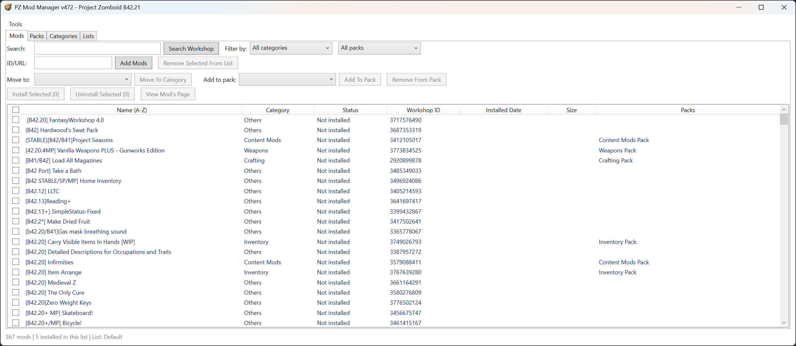

# PZ Mod Manager

A simple and easy-to-use tool designed to help players manage, organize, and install mods for **Project Zomboid** (Build 42).

No Steam client required — mods download directly via SteamCMD.

---

## Download

- **Latest Version** — see the [Releases page](https://github.com/duy64/PZModManager/releases) for the newest `.zip`
- **Platform:** Windows (PowerShell 5.1)
- **Format:** `.zip` archive

> **Note:** Project Zomboid (Build 42) is required. An internet connection is needed for SteamCMD mod downloads.

---

## Quick Start

1. Download the latest `.zip` from the [Releases page](https://github.com/duy64/PZModManager/releases).
2. Extract it anywhere (do not run it from inside the `.zip`).
3. Run `Run-ModManager.bat`.
4. Browse the built-in catalog, add mods to your list, select them and click **Install**.
5. Enable the mods in Project Zomboid's Mods menu and play.

---

## Features

### Mod Management
- 375-mod curated catalog for Project Zomboid B42
- Install / uninstall mods, single or in bulk
- Check for mod updates
- Add mods by Workshop ID, URL, or built-in Workshop search
- Subscriber counts, install dates, and per-mod status

### Packs & Categories
- 23 ready-made mod packs (Vehicles, Weapons, NPCs, Quality of Life, and more)
- 19 categories for organizing your mods
- Create your own custom packs and categories

### Lists (Profiles)
- Save separate mod setups as lists — e.g. single-player vs multiplayer
- Switch between setups with one click
- Export / import lists to share with friends

### Mod Health
- Compatibility report — flags mods incompatible with your game build
- Find and add missing dependencies automatically
- Multi-version mod support — auto-picks the variant matching your build

---

## FAQ

**Do I need Steam installed?**
No. The manager downloads mods through SteamCMD (anonymous login), so the Steam client is not required.

**Will it work with mods I already have?**
Yes — use the "Add Existing Mods" option to pick up mods already in your Zomboid mods folder.

**Is it safe?**
Every destructive action asks for confirmation first. Your lists, packs, and settings are stored as plain JSON files next to the script — easy to back up.

**Does it work in multiplayer?**
The server and every client must have the exact same set of mods. Export your list and share it so everyone installs the same mods.

---

## Credits & Disclaimer

Created by [duy64](https://github.com/duy64). Licensed under the MIT License (see LICENSE.txt).

Project Zomboid is developed by The Indie Stone. Steam and Steam Workshop are services of Valve. This is an unofficial community tool and is not affiliated with or endorsed by The Indie Stone or Valve. Use at your own risk — back up your saves before changing mods on an existing playthrough.
